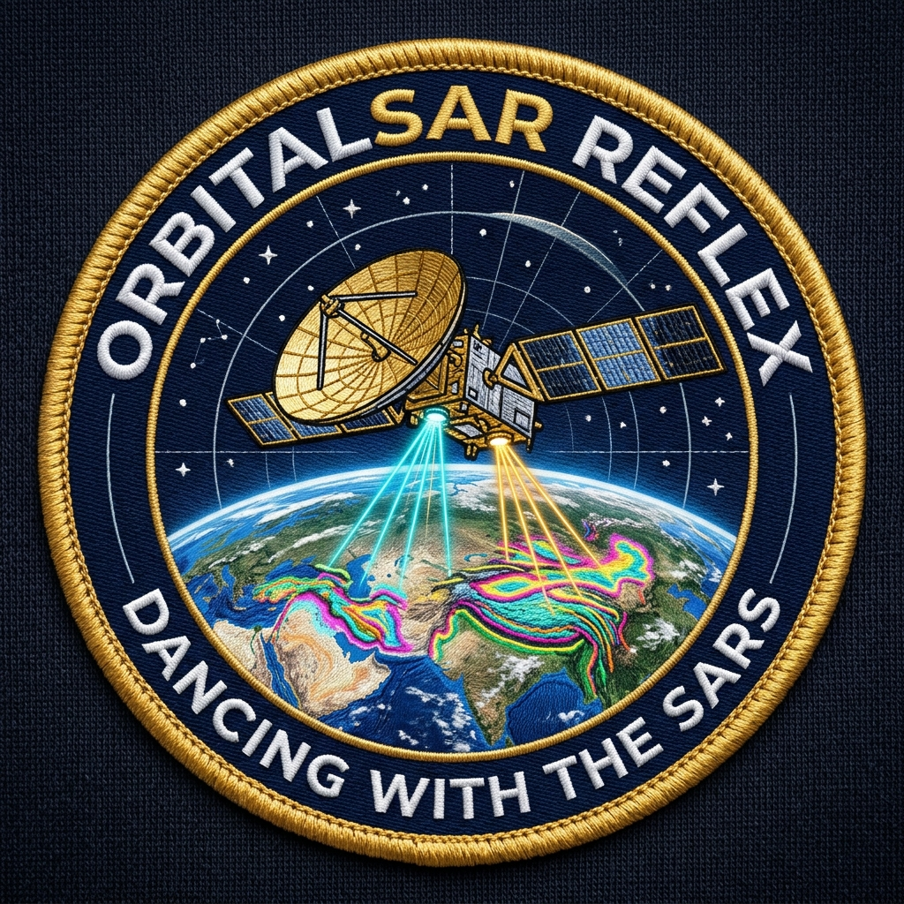

<p align="center">
  
</p>

# OrbitalSAR Reflex

**NASA Space Apps Challenge 2026 — *Dancing with the SARs***  
Autonomous SAR backscatter & coherence change-detection engine with **24-byte deterministic edge telemetry** for rapid Earth-observation anomaly response.

---

## Team & Event Details

- **Event:** NASA Space Apps Challenge 2026 (`Universal Event, Anywhere in the World`)
- **Challenge:** *Dancing with the SARs*
- **Team Page:** [OrbitalSAR Reflex on Space Apps](https://www.spaceappschallenge.org/2026/find-a-team/orbitalsar-reflex/?tab=details)
- **Members ([Team Roster](https://www.spaceappschallenge.org/2026/find-a-team/orbitalsar-reflex/?tab=members)):**
  - **Volkan Dagli** (`@pCwOrM`) — Team Owner
  - **Murat Emre ÖZKAYA**
  - **Prenses Metin** (`@PrensesMTN`)
- **Official Community & Rules:** [nasa/spaceapps](https://github.com/nasa/spaceapps) · [Space Apps Legal](https://www.spaceappschallenge.org/legal/)

---

## Core Concept

Synthetic Aperture Radar (SAR) penetrates clouds, smoke, and darkness to capture surface change, but raw SAR scenes are bandwidth-heavy to downlink and slow to triage during disasters. **OrbitalSAR Reflex** models an onboard/edge reflex pipeline:

1. **Multi-Temporal SAR Change Metrics:** Computes log-ratio backscatter change ($\Delta\sigma^0$ in dB) and interferometric coherence drop ($\Delta\gamma$).
2. **Deterministic Reflex Classification:** Classifies scenes into `NOMINAL`, `FLOOD_INUNDATION`, `SURFACE_DEFORMATION`, or `STRUCTURAL_DAMAGE`.
3. **24-Byte FNS Telemetry Packet:** Packs timestamp, geolocation, $\Delta\sigma^0$, $\Delta\gamma$, anomaly code, severity, and CRC-16 checksum into an exact **24-byte** binary frame for ultra-low-bandwidth downlink.
4. **Interactive Mission HUD (`web/index.html`):** Browser-based SAR anomaly & telemetry inspector.

---

## Repository Structure

```text
orbitalsar-reflex/
├── assets/
│   └── orbitalsar_reflex_mission_patch.jpg
├── docs/
│   └── ARCHITECTURE.md
├── src/
│   ├── __init__.py
│   └── sar_reflex_core.py
├── tests/
│   └── test_sar_reflex_core.py
├── web/
│   └── index.html
├── LICENSE
└── README.md
```

---

## Quickstart & Verification

Run the Python unit tests (zero external dependencies, Python 3.10+):

```bash
python -m unittest discover -s tests -v
```

Open `web/index.html` in any modern browser to test the interactive SAR Reflex HUD prototype.
